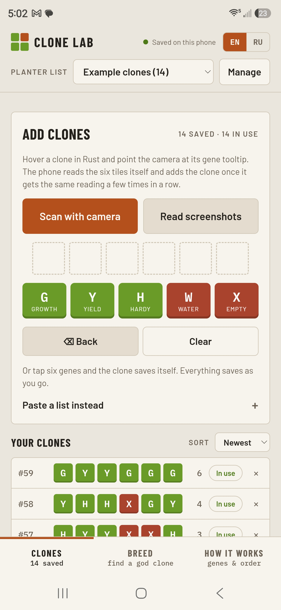
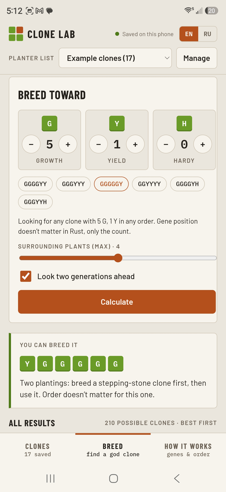
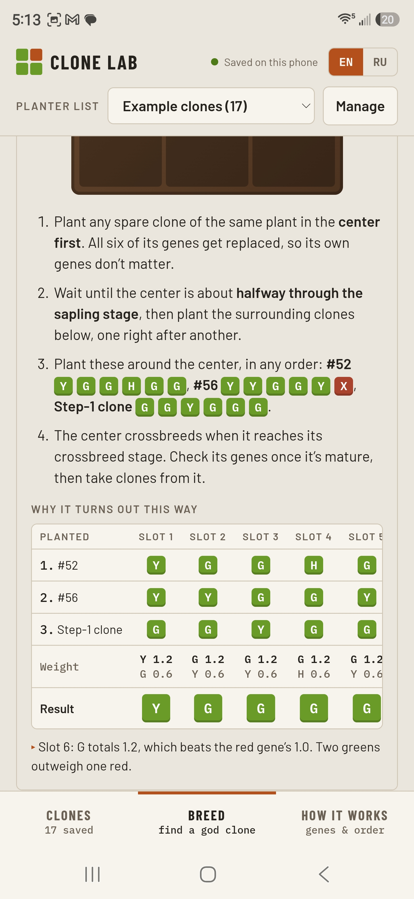
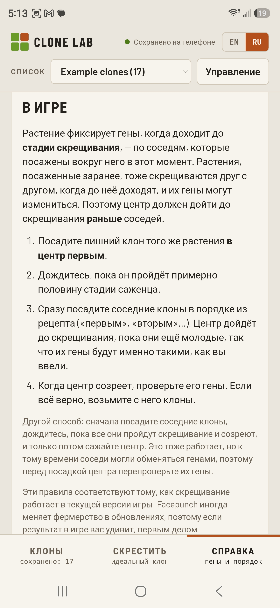

# Clone Lab — Android app

Rust clone breeding planner. Everything runs on the phone: gene scanning (camera or screenshots), saved lists, breeding search, planting order.

## Screenshots

  
  
  
  

More in [docs/screenshots](docs/screenshots). Privacy policy: [Clone Lab Privacy Policy](https://sites.google.com/view/clonelab-privacy/home)

## Build the APK (Windows, Android Studio)

1. Unzip this folder somewhere without spaces in the path, e.g. `C:\dev\clone-lab-app`.
2. In Android Studio: **File → Open** and pick the `android` folder inside it. Let Gradle sync finish (first time downloads Gradle and SDK parts).
3. **Build → Build App Bundle(s) / APK(s) → Build APK(s)**.
4. The APK lands in `android\app\build\outputs\apk\debug\app-debug.apk`.
5. Copy it to your phone and open it. Android will ask you to allow installing from that source once.

Or plug the phone in with USB debugging on and press **Run** in Android Studio to install directly.

Command line alternative (from the `android` folder): `gradlew.bat assembleDebug`

## Changing the app

The app is plain HTML/JS in `www/`:

- `engine.js` — breeding rules and search
- `scanner.js` — on-device gene tile reader
- `app.js` — UI, storage, camera

After editing `www/`, copy it into the Android project with `npx cap copy android` (needs Node; run `npm install` once first), then rebuild.

## Data

Lists are stored on the phone. Use **Manage → Copy backup** to save a copy, and **Restore** to load it on another phone.
